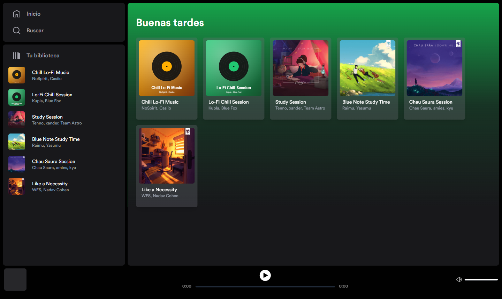
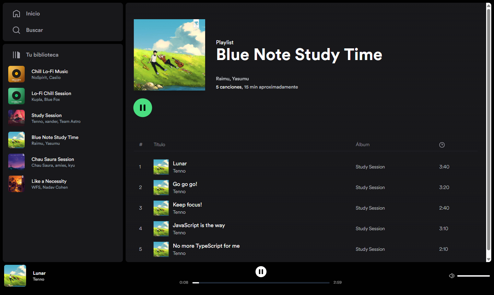

<div align="center">

# 🎧 Spotify Clone

Clon del reproductor web de **Spotify** construido con **Astro** y arquitectura de islas: componentes de
**React** y **Svelte** conviven en la misma app y la música no se corta al navegar entre playlists.

[](https://astro.build)
[](https://react.dev)
[](https://svelte.dev)
[](https://tailwindcss.com)
[](https://zustand-demo.pmnd.rs)
[](https://www.netlify.com)



</div>

---

## ✨ Funcionalidades

- 🎵 **Reproductor de música** con play/pausa, barra de progreso que permite saltar a cualquier punto, control de volumen y silencio.
- 🔁 **La música no se corta al navegar**: el reproductor persiste entre páginas gracias a las View Transitions de Astro.
- 📚 **Biblioteca lateral** y vista de inicio con todas las playlists.
- 📄 **Detalle de playlist** con portada, artistas, número de canciones, duración total y lista de temas.
- ▶️ **Reproducir desde cualquier tarjeta**, sin tener que entrar en la playlist.
- 👋 **Saludo según la hora**: «Buenos días», «Buenas tardes» o «Buenas noches».
- 🎨 Estética inspirada en Spotify, con un degradado de color propio en cada playlist.



## 🧠 Cómo funciona

| Pieza                       | Implementación                                                                                                                                                                                                                                                              |
| --------------------------- | --------------------------------------------------------------------------------------------------------------------------------------------------------------------------------------------------------------------------------------------------------------------------- |
| **Islas de interactividad** | Astro renderiza las páginas en el servidor y solo hidrata lo interactivo: el reproductor (`client:load`) y los botones de play (`client:visible`, que carga al aparecer en pantalla), ambos en **React**. El saludo es un componente **Svelte** renderizado en el servidor. |
| **Estado global**           | Un store de **Zustand** (`src/store/playerStore.js`) comparte la canción actual, la playlist, el estado de reproducción y el volumen entre islas independientes.                                                                                                            |
| **Navegación sin cortes**   | `<ViewTransitions />` y `transition:persist` mantienen vivo el reproductor al cambiar de página, con transiciones animadas entre tarjetas y portadas.                                                                                                                       |
| **API**                     | Un endpoint de Astro (`/api/get-info-playlist.json?id=…`) devuelve la playlist y sus canciones al pulsar play desde una tarjeta.                                                                                                                                            |
| **Despliegue**              | `output: 'server'` con el adaptador de **Netlify** (funciones SSR y edge middleware).                                                                                                                                                                                       |

## 🧰 Stack

- **Framework:** Astro 4 (SSR, View Transitions)
- **UI:** React 18, Svelte 4, Tailwind CSS 3, Radix UI (slider)
- **Estado:** Zustand
- **Despliegue:** Netlify (`@astrojs/netlify`)

## 📁 Estructura

```
src/
├── components/   Reproductor, tarjetas, menú lateral, tabla de canciones, saludo
├── icons/        Iconos SVG como componentes de Astro
├── layouts/      Layout principal (menú, contenido y reproductor persistente)
├── lib/          Datos de playlists y canciones, paleta de colores
├── pages/
│   ├── index.astro          Inicio
│   ├── playlist/[id].astro  Detalle de playlist
│   └── api/                 Endpoint con la información de cada playlist
└── store/        Store global del reproductor (Zustand)
public/
├── covers/       Portadas locales
├── fonts/        Tipografía Circular
└── music/        Pistas de audio de demostración
```

## 🚀 Puesta en marcha

Requisitos: **Node.js 18.17 o superior**.

```bash
git clone https://github.com/Javiguegadev/spotify-clone.git
cd spotify-clone
npm install
npm run dev        # http://localhost:4321
```

| Comando           | Acción                                 |
| ----------------- | -------------------------------------- |
| `npm run dev`     | Servidor de desarrollo                 |
| `npm run build`   | Build de producción (SSR para Netlify) |
| `npm run preview` | Previsualiza el build                  |

## 🙌 Créditos

- Proyecto basado en el clon de Spotify con Astro que [midudev](https://github.com/midudev) desarrolló en directo.
- La música lo-fi y las portadas se usan solo con fines de demostración. Los derechos pertenecen a sus autores.

## 👤 Autor

**Javier Guerrero**: [GitHub @Javiguegadev](https://github.com/Javiguegadev) · [Portfolio](https://javierguerrero-pf.netlify.app)

---

<sub>Proyecto educativo sin afiliación con Spotify AB. «Spotify» es una marca registrada de su propietario.</sub>
